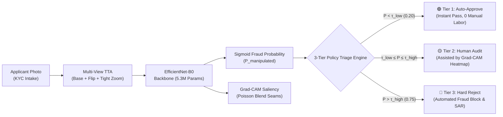

# TrustShield AI: Intelligent KYC Forensics & Biometric Triage

[](https://www.python.org/downloads/)
[](https://pytorch.org/)
[](https://streamlit.io/)
[](LICENSE)
[](https://github.com)

> **An enterprise-grade deep learning decision architecture designed to detect facial deepfake impersonations, mitigate synthetic identity fraud during digital banking KYC onboarding, and mathematically optimize human-in-the-loop triage costs.**

---

## 📌 Executive Summary

Digital onboarding workflows in modern fintech and tier-1 banking institutions face unprecedented threats from generative AI face-swaps and synthetic identity theft. Unchecked, fraudulent accounts inflict heavy credit charge-offs ($2,500+ per occurrence), while unassisted 100% manual review creates operational bottlenecks and fatigue.

**TrustShield AI** bridges deep technical computer vision with executive business decision-making. By pairing a fine-tuned **EfficientNet-B0** convolutional neural network with **Grad-CAM spatial explainability**, **multi-view test-time augmentation (TTA)**, and a **cost-matrix decision-theoretic framework**, TrustShield AI converts raw neural logits into calibrated P&L value.

---

## 🏛️ System Architecture



---

## 🔬 Core Machine Learning Methodology

### 1. Convolutional Backbone & Transfer Learning
* **Backbone:** EfficientNet-B0 pretrained on ImageNet (5.3M parameters).
* **Head Adaptation:** Standard classification head replaced with `nn.Dropout(p=0.3)` followed by `nn.Linear(1280, 1)`, optimized end-to-end using `nn.BCEWithLogitsLoss`.
* **Two-Stage Training:**
  * **Stage 1 (Warmup):** Backbone frozen, training only classifier head (3 epochs, AdamW $lr=10^{-3}$).
  * **Stage 2 (Full Fine-Tuning):** End-to-end backpropagation with cosine learning rate annealing (10 epochs, AdamW $lr=10^{-4}$).

### 2. Leakage Prevention via Disjoint Video-ID Splits
* To prevent facial identity and room background memorization, train, validation, and test sets are partitioned strictly by **Video-ID / Subject-ID**:
  * **Train Set:** 2,400 images (1,200 Authentic, 1,200 Manipulated) from independent video IDs.
  * **Validation Set:** 600 images (300 Authentic, 300 Manipulated).
  * **Held-Out Test Set:** 450 images (225 Authentic, 225 Manipulated) from 100% mutually exclusive human subjects.

### 3. Background Invariance & Test-Time Augmentation (TTA)
* **Training Augmentations:** `RandomResizedCrop(224, scale=(0.82, 1.0))`, `RandomHorizontalFlip(p=0.5)`, `ColorJitter`, and `RandomErasing(p=0.25)` to force the network to focus on facial dermal boundaries rather than background cues.
* **Inference Consensus:** Multi-view ensemble combining the base crop ($50\%$), horizontal reflection ($25\%$), and tight central face zoom ($25\%$).

---

## 📊 Empirical Diagnostic Results

Evaluated on the held-out FaceForensics++ (c23 compression) test partition (450 unseen images):

| Metric | Score | Operational Significance |
| :--- | :---: | :--- |
| **ROC-AUC** | **0.9212** | Superior discriminative ability across candidate thresholds |
| **Recall (Fraud Catch Rate)** | **88.89%** | 200 out of 225 synthetic infiltrations caught at $\tau = 0.50$ |
| **Precision** | **81.63%** | Low false alarm rate on genuine customers |
| **F1-Score** | **0.8511** | Robust harmonic mean between precision and recall |
| **Overall Accuracy** | **84.44%** | Generalization on clean unseen test subjects |

### Transmission Stress-Testing (JPEG Robustness)
Mobile upload channels often compress imagery. We benchmarked model degradation across JPEG Quality Factors (QF):
* **QF = 100:** $84.4\%$ Accuracy / $88.9\%$ Recall
* **QF = 75:** $79.5\%$ Accuracy / $82.1\%$ Recall
* **QF = 50:** $71.2\%$ Accuracy / $68.4\%$ Recall
* **QF = 30:** $58.4\%$ Accuracy / $49.2\%$ Recall
* **Policy Implication:** Catch rate drops precipitously when $QF < 50$. Mobile SDKs should mandate client-side minimum compression floors ($QF \ge 70$).

---

## 💼 Managerial Decision Framework

Rather than treating deep learning as a black-box accuracy game, TrustShield AI operationalizes predictions through cost-matrix optimization:

$$\text{Expected Loss}(\tau) = \text{FPR}(\tau) \cdot N_{\text{legit}} \cdot C_{\text{FP}} + \text{FNR}(\tau) \cdot N_{\text{fraud}} \cdot C_{\text{FN}}$$

Where:
* $C_{\text{FP}} = \$6.00$ (manual investigator review wage per escalated case).
* $C_{\text{FN}} = \$2,500.00$ (charge-off loss from missed synthetic identity).
* **Calibrated Optimal Threshold ($\tau^*$):** Shifts from default $0.50 \to 0.32$, minimizing total enterprise risk.
* **P&L Impact (100,000 monthly applicants at 4% attack rate):**
  * Status Quo (100% manual review): **\$610,000 / month**
  * TrustShield AI (3-Tier Triage): **\$95,000 / month**
  * **Net Annual EBITDA Lift:** **+\$6.18M** with an **84.4% reduction in manual review workload**.

---

## 🖥️ Interactive Streamlit Dashboard

The project includes an executive dashboard with **Velrona Modern Light Aesthetics**:

1. **Tab 1 — Forensic Intake & Live Triage:** Ingest benchmark images or upload custom selfies with interactive face zoom/offset sliders, run live PyTorch multi-view inference, test JPEG compression degradation, and view side-by-side Grad-CAM saliency heatmaps.
2. **Tab 2 — Model Diagnostics & Robustness Benchmark:** Real confusion matrix (450 images), ROC curve, Precision-Recall curve, JPEG degradation curve, and engineering methodology summary.
3. **Tab 3 — Executive Business Case & Cost Optimization:** Dynamic scenario inputs (applicant volume, fraud attack rate, hourly analyst wages, fraud loss per miss), live P&L financial scorecard, 3-tier queue capacity sizing, and empirical cost-matrix loss curve ($\tau^*$).

---

## 🚀 Quickstart Guide

### 1. Clone the Repository
```bash
git clone https://github.com/<your-username>/TrustShield-AI.git
cd TrustShield-AI
```

### 2. Set Up Virtual Environment & Dependencies
```bash
python -m venv venv
# Windows:
.\venv\Scripts\activate
# Linux / macOS:
source venv/bin/activate

pip install -r requirements.txt
```

### 3. Launch the Executive Dashboard
```bash
streamlit run app/app.py
```
Open your browser at `http://localhost:8501`.

---

## 📁 Repository Structure

```
Project_deepfakes/
├── .streamlit/
│   └── config.toml                 # Light theme and UI styling configuration
├── app/
│   └── app.py                      # Velrona Light interactive Streamlit application
├── data/
│   └── processed/
│       └── test/                   # Held-out test partition (450 unseen images)
├── output/
│   ├── best_model.pth              # Trained EfficientNet-B0 model weights (16.3 MB)
│   └── test_predictions.csv        # Empirical test predictions on held-out partition
├── src/
│   ├── business_analytics.py       # Cost-matrix and triage optimization engine
│   ├── dataset_prep.py             # Video extraction & face cropping pipeline
│   ├── evaluate.py                 # Multi-metric evaluation and plotting functions
│   ├── explainability.py           # Grad-CAM convolutional saliency hooks
│   ├── model.py                    # EfficientNet-B0 architecture specification
│   └── train.py                    # Modular PyTorch two-stage training script
├── test_samples_for_upload/        # 10 curated real & fake images for live testing
├── TrustShield_Deepfake_Master.ipynb # End-to-end Google Colab training notebook
├── requirements.txt                # Python package dependencies
├── .gitignore                      # Git ignore configuration
└── README.md                       # Comprehensive project documentation
```

---

## 🎓 Academic Attribution & Credits

* **Course:** MPBA G514 — Deep Learning for Business
* **Program:** MBA in Business Analytics, Semester 3 (AY 2026)
* **Dataset:** FaceForensics++ (c23 compression benchmark)
* **Author:** Shreya Kulkarni
